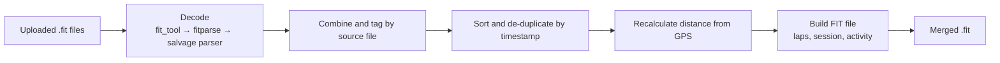

# FITJoin

Merge many `.fit` activity files into one. After cycling across the USA I had 80+ days of Strava files and wanted to see the ride as a single activity, so I built this as a FastAPI service, containerised it with Docker and deployed it to AWS.

**Live API docs:** https://fi-960f9df6d9f74ecd825d40a94940719b.ecs.eu-north-1.on.aws/docs

```bash
curl -X POST https://fi-960f9df6d9f74ecd825d40a94940719b.ecs.eu-north-1.on.aws/merge \
  -F "files=@day1.fit" \
  -F "files=@day2.fit" \
  -o merged_activity.fit
```

**Stack:** Python, FastAPI, pandas, fit_tool, fitparse, geopy, Docker, AWS (ECR, ECS Fargate)

## How it works



The output has one lap per input file and a rebuilt session and activity summary, so platforms like Garmin Connect and Strava accept it as a single activity.

## Interesting decisions

- **Three-stage decoder fallback.** Some of my real files were rejected by `fit_tool` and `fitparse` because of malformed definition messages. I added a minimal tolerant parser as a last resort that skips fields it can't read. I used AI to write it, then checked it against Garmin's FIT spec and tested it with unit tests, a hand-built FIT file and a round-trip comparison on a real file. ([details](docs/salvage-parser.md))
- **Distance is recalculated from GPS**, without counting the gaps between files as distance travelled.
- **Rebuilt summary messages.** Copying records alone made a viewer show only the first activity's map, so the session, laps and timer events are generated explicitly.
- **Stateless API.** Uploads are saved under generated filenames in a temp directory, never user-supplied names, and removed after each request.
- **Deployed twice on purpose:** manually on EC2 first, then on ECR and ECS Fargate, to understand what the managed services remove. ([write-up](docs/containerisation-and-deployment.md))

## Run locally

```bash
pip install -r requirements.txt
uvicorn main:app --reload
```

Or with Docker:

```bash
docker build -t fit-join .
docker run -p 8000:8080 fit-join
# http://localhost:8000/docs
```

## Tests

```bash
python -m unittest
```

## More detail

For further information on the salvage parser, containerization and deployment and design notes see the [longer form project notes](/docs/notes.md).

## Further work

CI/CD with GitHub Actions to push to ECR and redeploy, infrastructure as code (Terraform), a `/health` endpoint with CloudWatch alarms, and a non-root container user.