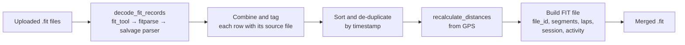

# Introduction
FIT (.fit) files are files produced by wearable or sports devices. They are commonly used for tracking sports activities by platforms like Garmin, Coros and Strava. After cycling across the USA, I wanted a way to join 80+ days worth of fit files to see the cycle as a whole. I also wanted to learn more about cloud deployments. The goals of this project are therefore to:
1. Develop a script that joins my Strava activities.
2. Improve my system design and architectural skills
3. Learn more about cloud deployments using AWS products.

# Understanding the Problem
I used an online tool to gain a basic understanding of the FIT format. The tool decoded the binary into plain text, showing a file containing a header, followed by a series of messages, some of which show sensor data like heart rate and cadence, which is tied to a timestamp and gps coordinate.

The solution follows an ETL (extract, transform, load) pipeline:


# System Design

Why FastAPI?
- Efficient
- Good developer experience, due to type annotations and ease to write.
- Supports OAuth2 and JWT tokens in case I want to add security further down the line.
- Asynchronous support - efficient handling of I/O bound operations such as file reads and writes - we can make good use of this.

Why Docker?
- Portability - self contained and isolated so they run consistently across environments - important as I'm using a mac and will be deploying to a cloud environment likely running linux or something. Docker containers ensure the application, its dependencies and therefore its outputs are consistent between environments.
- Dependancy management - we will make use of third party python pakcages. Including these in the container ensures they are always available. Removes the need for python installation itself in the production environment.
- Easy deplyment.

AWS decisions? 
- AWS is a popular cloud platform. I wanted to learn it. Realistically however, it is not the cheapest option for this project, which would work just fine self hosted on a raspberry pi or similar.
- Pre-built ways to deploy docker containers.
- Much higher levels of control compared with platforms like Supabase or Render

# Python 

Each function in the program has a single responsibility as detailed in the table below.

|Function|Responsibility|
|---|---|
|`decode_fit_records`|Decode one FIT file|
|`_load_sources`|Combine records and track their source files|
|`_sort_and_deduplicate`|Sort by timestamp and remove duplicates|
|`recalculate_distances`|Recalculate cumulative distance|
|`_build_fit_file`|Construct the output and summary messages|
|`merge_fit_files`|Orchestrate the pipeline and save the result|

#### Fit File Decoding
Originally, I had planned to use fit-tool, a python library for working with fit files. That didn't quite go to plan so a standardised `DecodedFile` representation ensures every decoder returns data in the same format, so downstream functions remain independent of the decoding library.

When testing fit-tool, I found that my fit files had several malformed header definitions, which caused certain records to not be read, or the program to crash. My solution was to use fit-tool primarily, then falling back to fitparse - a more tolerant parser. A third fallback was later implemented - a custom parser which simply skips over malformed records. This was well beyond the initial scope of the project so I outsourced the work to AI, then checked it against the FIT spec to understand how it works:
- Each message in a fit file starts with its own one byte header which describes the type of message, which fields it has, how big they are and what the data types are.
- The custom parser reads the raw bytes itself, skips any field it can't interpret and keeps only the core record data. One drawback of this is that some custom, less common fields may be ignored, but it works well for this use case.

To ensure the parser's trustworthiness, I wrote unit tests, including one on a small handmade FIT file. I also parsed a real file and re-encoded it to check for data loss. It's MD5 checksum was different, but this was expected and on visual inspection the data was essentially unchanged.

The new requirement for a custom parser also meant I could make use of pandas directly, without having to decode to csv format, reducing I/O operations significantly.
#### Sorting
Records are sorted chronologically, discarding the first record when timestamps overlap.

#### Distance Recalculation
Distance is a cumulative field, meaning it must be recalculated for each record. This was done using geopy's geodesic function, which measures distance using WGS-84 projection.

#### Rebuilding FIT File
The FIT file needs new metadata since it represents a different activity (it is now the combination), and therefore a new header.

- **File ID:** Uses `ACTIVITY` and `DEVELOPMENT` identifiers, with product and serial numbers set to zero.
- **Sport:** Inherits the first usable input's sport and sub-sport, defaulting to `GENERIC`.
- **Laps:** Creates one lap per input file to preserve the original segments.
- **Timer events:** Adds start and stop events for each segment so gaps between files are excluded from timer time.
- **Session:** Creates one session spanning the merged activity, with timer time summed across segments.
- **Activity:** Creates one manually assembled activity containing the session.

I initially found that a viewer displayed only the first activity's map despite all records being present. Although I couldn't establish the exact cause, this highlighted the importance of rebuilding summary messages rather than relying solely on the records.

Small `_make_*` functions handle individual message types, keeping `_build_fit_file` readable.

## Performance 
Sorting dominates the theoretical time complexity at (O(N\log N)), where (N) is the number of records. Other stages are broadly (O(N)). The per-record geodesic calculations may be the main bottleneck, although I have not profiled them. If necessary, they could be optimised using vectorised calculations with `pyproj.Geod`.

Memory usage grows with the number of records and the overhead of pandas and FIT message objects. The expected workload should be benchmarked with the maximum number of files before setting container memory limits.

The API is stateless: each request processes its uploads independently and deletes temporary files. This makes horizontal scaling straightforward.

## API Layer
The FastAPI endpoint follows a simple **validate, delegate, respond** pattern.

- **Validation:** Rejects filenames that do not end in `.fit`, returning HTTP `400`.
    
- **File safety:** Saves uploads under generated filenames in a temporary directory, avoiding path traversal through user-supplied filenames.
    
- **Cleanup:** Removes temporary files after the response or immediately on error.
    
- **Concurrency:** Uses a synchronous `def` endpoint because the merge involves CPU-intensive pandas operations and geodesic calculations. FastAPI runs synchronous endpoints in a worker thread pool, avoiding blocking the event loop directly. However, scaling may require additional container instances.

## Verification
I tested the implementation in three ways:

- **Round-trip validation:** Decoded the output and confirmed the expected record count and GPS data from both inputs. 
- **Regression testing:** Compared the original and refactored implementations across normal, malformed, GPS-less and mixed inputs, including files with big-endian data, developer fields and compressed timestamps. The output files were byte-for-byte identical.


# Containerisation and Deployment

I deployed the application twice, first by hand on EC2 and then on ECS Fargate, so I could see what the managed services actually save you from.

**Live API docs:** https://fi-960f9df6d9f74ecd825d40a94940719b.ecs.eu-north-1.on.aws/docs#/

**Example request:**

```bash
curl -X POST https://https://fi-960f9df6d9f74ecd825d40a94940719b.ecs.eu-north-1.on.aws/merge \
  -F "files=@day1.fit" \
  -F "files=@day2.fit" \
  -o merged_activity.fit
```

---

## Containerising with Docker

### Key concepts

- **Dockerfile:** a text file describing how to build an image.
- **Image:** a read-only template containing the code, dependencies and configuration needed to run the app.
- **Container:** a running instance of an image, isolated from the host.

### The Dockerfile

```dockerfile
FROM python:3.11-slim-bookworm

WORKDIR /app

COPY requirements.txt .
RUN pip install --no-cache-dir -r requirements.txt

COPY . .

EXPOSE 8080

CMD ["uvicorn", "main:app", "--host", "0.0.0.0", "--port", "8080"]
```

|Instruction|Purpose|
|---|---|
|`FROM`|Base image. I used a slim Python image matching my virtualenv version to keep the image small.|
|`WORKDIR`|Directory inside the container where the code lives.|
|`COPY requirements.txt` then `RUN pip install`|Dependencies are installed before the code is copied, so Docker can reuse the cached layer when only the code changes.|
|`COPY . .`|Copies the application code. A `.dockerignore` keeps test FIT files out of the image.|
|`EXPOSE 8080`|Documents the port the app listens on.|
|`CMD`|Starts uvicorn on `0.0.0.0` so it is reachable from outside the container.|

Port 8080 is a common convention for containers rather than a FastAPI default (uvicorn defaults to 8000). I chose it deliberately and made sure it matched everywhere it appears later.

### Build and run

```bash
docker build -t fit-join .
docker run -p 8000:8080 fit-join
```

`-p 8000:8080` maps **host port 8000** to **container port 8080**. The app listens on 8080 inside the container, and outside it I reach it on 8000.

### Optimisation and security notes

What I applied:

- Ordered the Dockerfile so rarely-changing steps come first (layer caching).
- Used a slim base image and `.dockerignore`.
- Kept the number of `RUN` layers low and avoided leaving the pip cache in the image.

What I would add for production:

- Run as a non-root user inside the container.
- Multi-stage build if build-only dependencies appear.
- Image vulnerability scanning (ECR can scan on push) and regular rebuilds to pick up base image fixes.
- Container resource limits (`--memory`, `--cpus`) to stop one container consuming everything.

---

## 2. Deployment attempt 1: EC2 with SFTP

I started with the approach I already understood: a Linux virtual machine in the cloud.

### Setup

- **AMI:** Ubuntu. **Instance type:** `t4g.micro`, the smallest option in the free tier. It is ARM-based (Graviton), which matched the image I built on my Apple Silicon Mac.
- **Key pair:** ED25519, `.pem` format for OpenSSH. The public key lives on the server and the private key stays on my machine. Connecting proves I hold the private key, so no password is sent. I ran `chmod 400` on the key file so only my user can read it, because SSH refuses keys with loose permissions.
- **Network:** SSH open to any IP because my home IP changes. Acceptable for a short-lived project with key-only login. In a real setup I'd restrict it, or use a bastion host or AWS Systems Manager Session Manager.

### Moving the image to the server

```bash
# on my machine
docker save fit-join:latest | gzip > fit-join.tar.gz
sftp -i key.pem ubuntu@<instance-ip>
sftp> put fit-join.tar.gz

# on the instance
docker load < fit-join.tar.gz
sudo docker run -d --restart unless-stopped -p 8000:8080 fit-join:latest
```

SFTP isn't FTP. It is a file transfer feature of SSH, so it needs no separate FTP server and uses the same key as logging in. `-d` runs the container in the background and `--restart unless-stopped` keeps it alive after SSH closes or the instance reboots.

### The debugging story

The container ran, and `curl localhost:8000/docs` on the instance returned 200, but I couldn't reach it from outside. I narrowed it down layer by layer:

1. **App:** worked locally on the instance, so not an application problem.
2. **Docker port mapping:** `docker ps` showed `0.0.0.0:8000->8080`, so the mapping was fine.
3. **Isolating Docker:** I stopped the container and served a plain `python3 -m http.server` on port 8000. It was still unreachable, so the problem was on the AWS side.
4. **Security group:** the inbound rules only allowed HTTPS (443), SSH (22) and HTTP (80). There was no rule for port 8000, even though I believed the instance was open to everyone.

Two smaller lessons along the way: allocating an Elastic IP does nothing until it is **associated** with an instance, and the console's "HTTP" rule type forces port 80, so a custom port needs the **Custom TCP** type.

### Why I moved on

- I'm responsible for the whole machine: OS updates, Docker installation, restarts.
- It bills continuously, even when idle. A small instance cost me around 30p over 24 hours with nothing using it.
- It doesn't scale: nothing starts extra containers under load.
- Copying tarballs by hand doesn't version anything and can't be automated.

---

## 3. Deployment attempt 2: ECR and ECS Fargate

### Amazon ECR (where images are stored)

ECR is a container registry, comparable to a git remote for images: versioned, pushed and pulled. It replaces the tarball-and-SFTP step, only uploads changed layers, and lets a CI pipeline (GitHub Actions or Bitbucket Pipelines) push on every commit without any server keys in the repo.

1. Create an ECR repository.
2. Install and configure the AWS CLI.
3. Follow the repository's "View push commands" steps: authenticate Docker, `docker build`, `docker tag`, `docker push`.

### Amazon ECS on Fargate (where containers run)

ECS runs containers for you. With Fargate there is no server to manage: I describe the container (image, CPU, memory, port) and AWS runs it. I used **ECS Express Mode**, which provisions the surrounding infrastructure automatically:

- an Application Load Balancer with an HTTPS certificate and a stable DNS name
- security groups
- autoscaling and a rollback alarm

### What went wrong

The first deployment failed with "tasks failed to start", followed by "rollback failed: no rollback candidate". The second message was a side effect: a first deployment has no earlier healthy version to roll back to. The real cause was the **container port**. Express Mode defaults to port 80 but my app listens on 8080, so the load balancer's health checks never passed. After I recreated the service with port 8080, it deployed. At the same time I reduced the CPU and memory allocation to cut cost.

### Request path

```
client --HTTPS--> Application Load Balancer --> target group --> Fargate task :8080 --> uvicorn --> FastAPI
```

---

## 4. Cost control and tear-down

|Resource|Bills when|Action to stop it|
|---|---|---|
|EC2 instance|Running, even if idle|Terminate it (stopping still leaves disk charges)|
|Elastic IP|Allocated, associated or not|Release it|
|Fargate service|A task is running|Set desired count to 0, or delete the service|
|Application Load Balancer|Hourly, always|Delete the service so the ALB and target groups go with it|

Practices I followed: billing alerts and a budget set up before deploying, small resource sizes, and checking the console afterwards that load balancers, target groups, volumes and IPs were really gone. The trade-off with Express Mode is that the load balancer carries a fixed hourly cost, which is a lot for a hobby project, so I delete the service when I'm not demoing it.

---

## 5. What I'd do next

- **CI/CD:** a GitHub Action that builds the image, pushes it to ECR and triggers a new ECS deployment on each commit.
- **Infrastructure as code:** Terraform or CloudFormation, so the whole stack builds and tears down with one command.
- **Observability:** CloudWatch alarms and a dedicated `/health` endpoint for the load balancer health check.
- **Hardening:** non-root container user, least-privilege IAM roles, image scanning, and a restricted security group.
- **Statelessness:** the service processes uploads and returns the result without keeping data, so any temporary files should be cleaned up. For large uploads, S3 pre-signed URLs would avoid pushing big files through the API.
- **Cheaper hosting for bursty traffic:** AWS Lambda with a container image would scale to zero, though it needs an adapter for FastAPI.

## Key takeaways

- Doing it manually first made it clear what ECR, ECS and Fargate automate and why they exist.
- Most of my failures were networking or configuration (ports, security groups), not code, and isolating one layer at a time found them quickly.
- Managed services make deployment easy, but cost, security and reliability still need deliberate decisions.